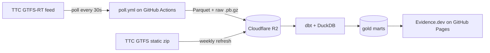

# TTC Streetcar Headway & Bunching Pipeline

Measures **headway adherence and bunching** on TTC streetcar routes from the
public GTFS-Realtime feed, at 30-second resolution, on free-tier infrastructure
only. Hero route **504 King**; **501 Queen** and **505 Dundas** as comparison.

> ### 🚧 Collection in progress
> The collector and pipeline are being built and hardened. The headline finding,
> the heatmap, and the live dashboard land once the 14-day collection window
> completes. Sections below marked _(pending)_ arrive with that data.

## The finding

_(pending — expected after the collection window)_

> Riders on the 504 King wait **X minutes** longer than the schedule implies
> during the PM peak, concentrated at **[location]**.

## Heatmap

_(pending)_ — bunching by timepoint × hour-of-day, the 504 King.

## Architecture



No orchestrator daemon and no always-on host: GitHub Actions is the executor,
dbt is the DAG, dbt docs is the lineage view. Ephemeral compute, short-lived
credentials, nothing to patch.

## Why this repo is public

The collector runs ~9.5 minutes of every 10, which exhausts the free-tier
Actions minutes for a *private* repo in under two days. Public repos get
unlimited minutes, so the repo is public **by design** — which means every
security control is load-bearing, not decorative (see `SECURITY.md`).

## Scope

**In scope:** streetcar routes 501 / 504 / 505; headway adherence, bunching, and
excess wait time; a 14-day collection window covering weekday peaks and weekends.

**Out of scope:** subway, buses, fares, ridership, prediction, anything
real-time-facing. The whole city's surface feed is *ingested* (one request
returns everything), but only the three streetcar routes are *modelled*.

## Quickstart

```bash
git clone https://github.com/raiyan979/ttc-headway
cd ttc-headway
uv sync
uv run pytest -q                     # offline test suite, no network
uv run python -m ttc_headway.poll     # one local collection cycle -> ./data/raw
```

_(pending)_ Offline reproduction of the gold tables from committed sample data
(`dbt build`, no credentials) arrives with the transformation phase — it is
definition-of-done item #5.

## Data model

dbt's folder convention (`staging` / `intermediate` / `marts`) maps to the
medallion vocabulary reviewers pattern-match on:

| dbt layer | Medallion | Role |
|---|---|---|
| `staging` | bronze | faithful to source; duplicates present |
| `intermediate` | silver | deduped, geometry, schedule joins |
| `marts` | gold | aggregated, published, privacy-safe |

Every model declares its grain; each mart is tested for row count = distinct key
count. Models marked _(Phase 3)_ are designed but not yet built.

| Layer | Model | Grain | Status |
|---|---|---|---|
| staging | `stg_vehicle_positions` | one row per feed record per poll (dupes) | Phase 3 |
| intermediate | `int_vehicle_observations` | one row per distinct vehicle observation | Phase 3 |
| intermediate | `int_timepoint_crossings` | one row per vehicle × timepoint × crossing | Phase 3 |
| marts | `mart_headway_events` | one row per observed headway at a timepoint | Phase 3 |
| marts | `mart_bunching_events` | one row per classified bunching/gap event | Phase 3 |
| marts | `mart_route_hour_summary` | route × direction × service_date × hour | Phase 3 |
| marts | `mart_ingestion_health` | one row per poller run window | Phase 3 |

The collector (staging inputs) is built and tested; the dbt models are the next
phase.

## Limitations

Stated plainly, because a free-tier pipeline has gaps and pretending otherwise
is the tell:

- **Ingestion gaps** from free-tier Actions cron firing late. Measured
  completeness: _(pending)_. An ingestion-health chart shows exactly where.
- **30-second sampling resolution** — the measurement floor for a bunching event.
- **Diversions** (notably the 501) put vehicles off their route geometry; these
  are flagged and excluded from scheduled comparison, not silently dropped.
- **No subway coverage** — streetcars only.

## Privacy

Vehicle position data is public and not personal, but a single vehicle's trace
across a shift approximates one operator's shift. Vehicle IDs are used only in
the raw and intermediate layers for the headway join; every published output
(marts, dashboard, findings) is aggregated to route × direction × timepoint ×
hour. See `SECURITY.md`.

## Collection window

14 consecutive days, beginning when the collector is enabled. The collector is
**intentionally disabled** at the end of the window — this is a time-boxed
experiment, not a job left running against a public agency's endpoint forever.
Exact dates recorded here once collection starts.

## Licence

Code: MIT (`LICENSE`). Data: Open Government Licence – Toronto, TTC as source;
not affiliated with or endorsed by the TTC or the City of Toronto
(`DATA_LICENSE.md`).
